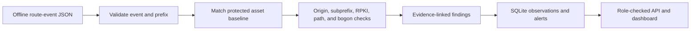

  

# RouteSentinel

RouteSentinel replays offline BGP route events against protected-prefix origin baselines and reports suspicious announcements with evidence.

## MVP and safety boundary

- Offline JSON replay only. There are no RIS/MRT live feed connections or BGP sessions.
- Checks configured protected prefixes for unexpected origin AS, more-specific subprefix, invalid RPKI status, long AS paths, and bogon ranges.
- Alerts retain the observed prefix, origin, AS path, timestamp, source label, severity, confidence, and suggested review action.
- Viewer/operator/admin roles guard all routes except health.
- No route announcements, withdrawals, device changes, or automated mitigation occur.

Add a monitored asset before replay. The dashboard offers a demo asset using the documentation prefix 203.0.113.0/24. For real assets, use POST /api/v1/assets with the operator token and your verified prefix/allowed origins.

## How it works

RouteSentinel replays offline BGP route observations against an operator-configured protected-prefix and origin baseline.

Each finding retains the observed route details and a review suggestion. The demo uses documentation-only address space. There are no live route feeds or BGP sessions, and the application cannot announce, withdraw, or mitigate routes.

## Run locally

Requires Python 3.11+ and Node.js 20+.

~~~powershell
cd D:\Projects\Devops_Engineer\RouteSentinel
uv sync --extra dev
Copy-Item .env.example .env
uv run python -m routesentinel
~~~

API docs: http://127.0.0.1:8020/docs.

~~~powershell
cd D:\Projects\Devops_Engineer\RouteSentinel\dashboard
npm install
npm run dev
~~~

Replace the example local tokens before use beyond a local demo.

## Verify

~~~powershell
uv run pytest
npm --prefix dashboard run build
~~~

SQLite data resides in ignored data/. Events are stored as route observations and generated findings.

