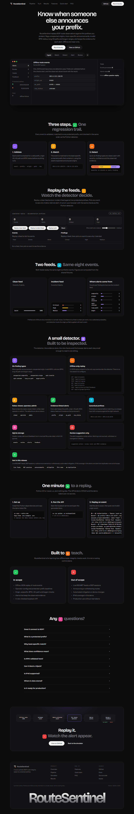
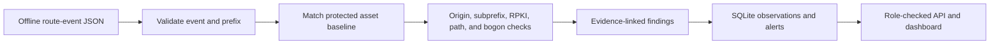

  

<h1 align="center">RouteSentinel</h1>

RouteSentinel replays offline BGP route events against protected-prefix origin baselines and reports suspicious announcements with evidence.

**Live site:** https://nihalmachhi.github.io/RouteSentinel/

The dashboard is a static React demo. Every prefix, ASN, alert and confidence
value on it is synthetic; it does not call the API and it does not touch a live
route feed.

## MVP and safety boundary

- Offline JSON replay only. There are no RIS/MRT live feed connections or BGP sessions.
- Checks configured protected prefixes for unexpected origin AS, more-specific subprefix, invalid RPKI status, long AS paths, and bogon ranges.
- Alerts retain the observed prefix, origin, AS path, timestamp, source label, severity, confidence, and suggested review action.
- Viewer/operator/admin roles guard all routes except health.
- No route announcements, withdrawals, device changes, or automated mitigation occur.

Add a monitored asset before replay. The dashboard offers a demo asset using the documentation prefix 203.0.113.0/24. For real assets, use POST /api/v1/assets with the operator token and your verified prefix/allowed origins.

## How it works

RouteSentinel replays offline BGP route observations against an operator-configured protected-prefix and origin baseline.

Each finding retains the observed route details and a review suggestion. The demo uses documentation-only address space. There are no live route feeds or BGP sessions, and the application cannot announce, withdraw, or mitigate routes.

## Run locally

Requires Python 3.11+ and Node.js 20+.

~~~powershell
cd D:\Projects\Devops_Engineer\RouteSentinel
uv sync --extra dev
Copy-Item .env.example .env
uv run python -m routesentinel
~~~

API docs: http://127.0.0.1:8020/docs.

~~~powershell
cd D:\Projects\Devops_Engineer\RouteSentinel\dashboard
npm install
npm run dev
~~~

Replace the example local tokens before use beyond a local demo.

## Dashboard

The dashboard ports the detector's rules to TypeScript so the page can replay two
synthetic feeds entirely in the browser. It uses React 18, TypeScript strict mode
and Vite 5, with no UI library and no router.

~~~powershell
cd dashboard
npm ci
npm run dev
~~~

Open the printed URL. The dev server serves the app under `/RouteSentinel/`.

| Command | What it does |
| --- | --- |
| `npm run dev` | Start the Vite dev server |
| `npm run build` | Type-check and build to `dist/` |
| `npm run preview` | Serve the production build |
| `npm run lint` | Run ESLint, including the accessibility rules |
| `npm run typecheck` | Run `tsc --noEmit` |
| `npm run test` | Run the Vitest suite |
| `npm run test:coverage` | Run Vitest with the coverage gate |
| `npm run e2e` | Run the Playwright smoke and visual specs |

Visual baselines live in `dashboard/e2e/visual.spec.ts-snapshots/` and are
captured on Windows. The CI workflow runs the smoke spec on Linux; refresh the
baselines locally with:

~~~powershell
npx playwright test e2e/visual.spec.ts --update-snapshots
~~~

The dashboard docs explain the port, the trade-offs and the backend gaps:

- [Learn](dashboard/docs/LEARN.md) — a guided walkthrough of the engine, fixtures,
  simulator, tour and tests.
- [Decisions](dashboard/docs/DECISIONS.md) — why the page is built this way.
- [Backend notes](dashboard/docs/BACKEND-NOTES.md) — verified limitations,
  including IPv6, origin/AS-path trust and duplicate replays.

## Verify

~~~powershell
uv run pytest
npm --prefix dashboard run lint
npm --prefix dashboard run typecheck
npm --prefix dashboard run test:coverage
npm --prefix dashboard run build
npm --prefix dashboard run e2e
~~~

SQLite data resides in ignored data/. Events are stored as route observations and generated findings. The dashboard does not read or write that database.

